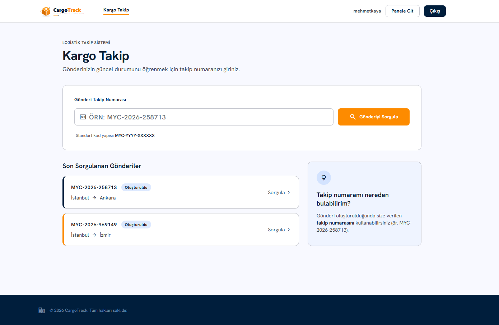
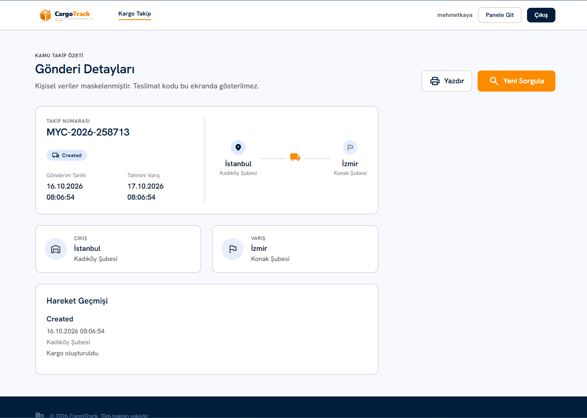
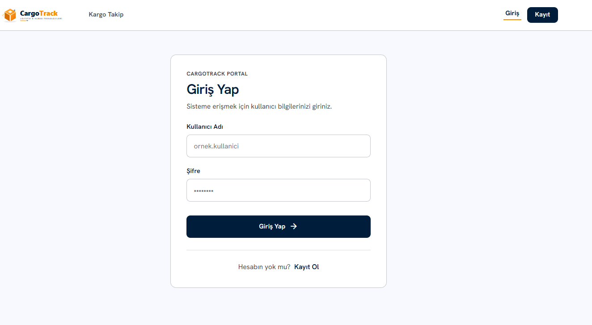
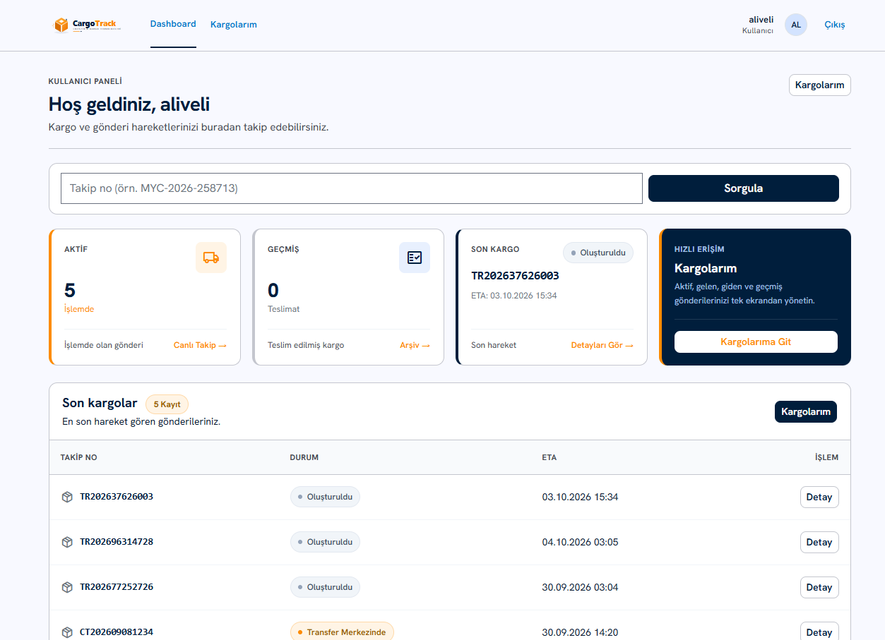
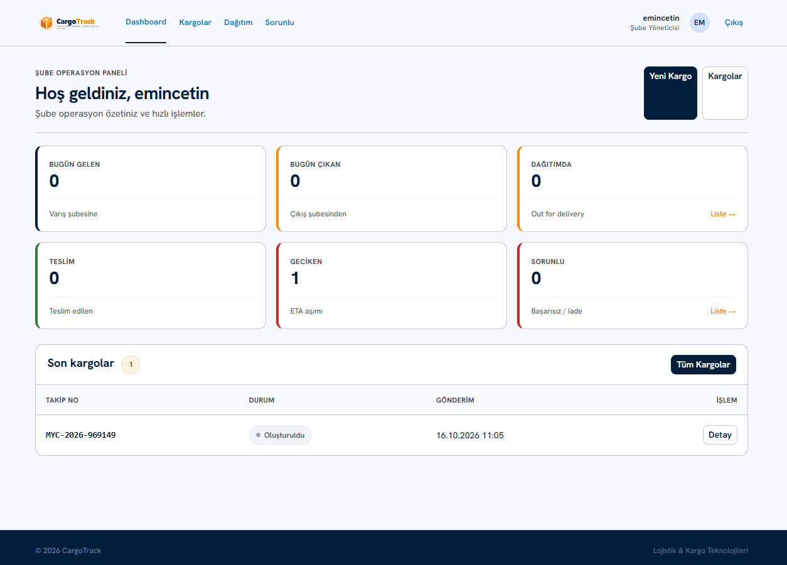
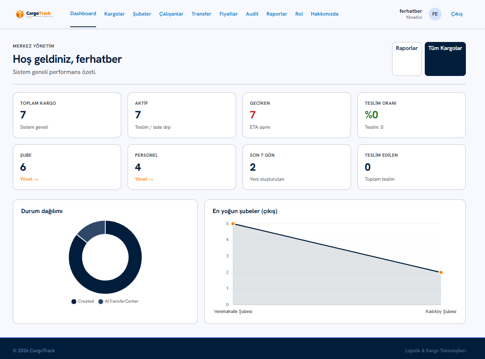
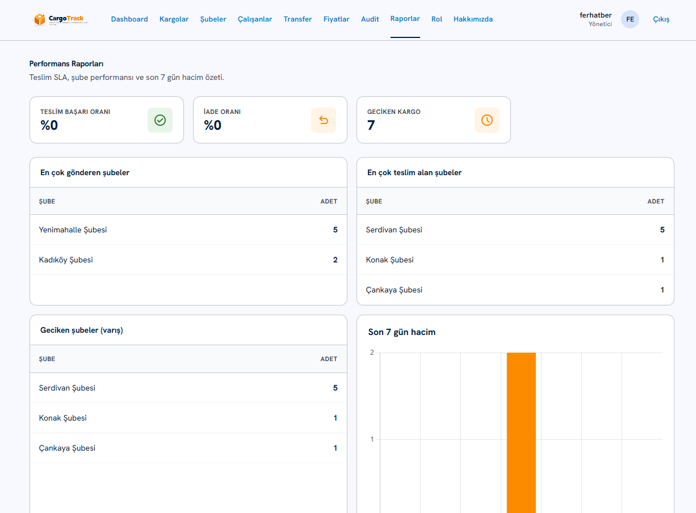

# CargoTrack

ASP.NET Core 8 MVC ile geliştirilmiş, rol bazlı bir kargo takip ve şube operasyon uygulaması.

Amaç: Sadece CRUD değil; durum geçişleri, teslimat doğrulama, fiyat hesaplama ve yetki filtresinin **Service** katmanında yaşadığı bir N-Layer örnek.

Kod İngilizce, arayüz Türkçe.

---

## Ne yapıyor?

| Alan | Açıklama |
|------|----------|
| Public takip | Takip numarası ile giriş olmadan durum / güzergâh / hareket geçmişi (kişisel veri yok) |
| Admin | Tüm kargolar, şube, transfer merkezi, personel, fiyat, audit log, rapor, rol atama |
| Manager | Yalnızca kendi şubesinin kargoları; oluşturma, durum değiştirme, dağıtım / sorunlu listeler |
| User | Gönderdiği veya aldığı kargolar; dashboard + sekme listeleri |

İş kuralları özeti: izinli durum geçişleri, hareket kaydı, teslimatta **DeliveryCode** kontrolü, başarısız deneme → iade akışı, SLA/ETA ve geciken kargo metrikleri.

---

## Ekran görüntüleri

### Public takip


### Gönderi detayı


### Giriş


### User dashboard


### Manager kargo listesi


### Admin dashboard


### Admin raporlar


---

## Teknolojiler

- .NET 8 / ASP.NET Core MVC (Areas: Admin, Manager, User)
- Entity Framework Core + SQL Server
- ASP.NET Core Identity (Admin / Manager / User)
- Repository pattern (generic + domain repository’ler)
- Mapster (Business katmanında mapping)
- FluentValidation
- Chart.js (Admin dashboard)
- Bootstrap (panel) + Tailwind CDN (public shell)

---

## Mimari

```
WebUI  →  Business  →  DataAccess  →  Entity
              ↑
             DTO
```

- Controller ince kalır; iş kuralı Service’te
- Generic Service yok; her domain kendi `I*Service` / `I*Repository` çiftine sahip
- Soft delete (`IsDeleted`) + Created/UpdatedDate
- Kritik işlemlerde AuditLog
- Global exception middleware + kullanıcı dostu hata sayfaları

---

## Fiyatlandırma (tasarım notu)

Bu projede ücret, `CargoType` + `PackageSize` (sabit desi karşılığı) ve `CargoPrice` tablosu üzerinden `CargoPricingService` ile hesaplanır.

Amaç: Admin’in fiyat kuralını yönetebilmesi ve kargo oluştururken tutarın otomatik üretilmesi.

---

## Kurulum

### Gereksinimler

- .NET 8 SDK
- SQL Server (LocalDB / Express yeterli)

### 1. Bağlantı dizesi

`CargoTrack.WebUI/appsettings.Development.json`:

```json
{
  "ConnectionStrings": {
    "DefaultConnection": "server=localhost;database=CargoTrackDb;integrated security=true;trustServerCertificate=true"
  }
}
```

Kendi sunucu adınla değiştir.

### 2. Çalıştırma

```bash
dotnet run --project CargoTrack.WebUI --launch-profile http
```

Varsayılan adres: **http://localhost:5193**

İlk açılışta `EnsureCreated()` ile şema oluşturulur; şehir / rol / örnek fiyat seed’i `Program.cs` içinde çalışır.

> Not: Identity kullanıcıları Register ekranından oluşturulur; Admin/Manager rolleri **Rol Atama** ekranından verilir. Manager’ın şube bağlantısı Employee kaydıyla ilişkilidir.

### Public takip örnekleri

Ana sayfada örnek takip kartları bulunur (ör. `MYC-2026-258713`). Veritabanında karşılığı olan takip numaralarıyla sorgulama yapılabilir.

---

## Solution yapısı

```
MyAcademy_CargoTrack/
├── screenshots/             # README ekran görüntüleri
├── CargoTrack.Entity/       # Domain + enum’lar
├── CargoTrack.DTO/          # Create / Update / Result DTO’lar
├── CargoTrack.DataAccess/   # DbContext, repositories, migrations
├── CargoTrack.Business/     # Services, validators, pricing, dashboard, reports
└── CargoTrack.WebUI/        # MVC, Areas, public layout, Identity
```

---

## Öne çıkan ekranlar

**Public:** `/Default/Index`, `/Default/CargoDetails`  
**Auth:** `/Login`, `/Register/Signup`  
**User:** `/User/Dashboard`, `/User/Cargo`  
**Manager:** `/Manager/Dashboard`, `/Manager/Cargo`, `OutForDelivery`, `Problematic`, `ChangeStatus`  
**Admin:** `/Admin/Dashboard`, `/Admin/Cargo`, `/Admin/Report`, Branch / TransferCenter / Employee / CargoPrice / AuditLog / RoleAssign / About

---

## Öğrenme çıktıları

- N-Layer sorumluluk ayrımı
- Identity + RBAC + **veri seviyesinde** filtre (Manager şube, User kendi kargoları)
- Durum makinesi ve teslimat kodu iş kuralı
- DTO + Mapster + FluentValidation
- Soft delete, audit log, pagination / filter
- Rol bazlı dashboard ve rapor aggregation

---

## Not

Kurs case çalışması — öğrenme ve portföy amaçlıdır.
